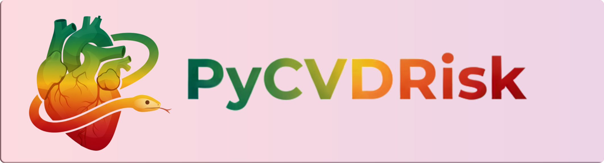

<div align="center">
  

### Cardiovascular risk scores from across the world, verified, in Python

[](https://pypi.org/project/cvd-risk/)
[](https://pepy.tech/project/cvd-risk)
[](https://pypistats.org/packages/cvd-risk)
[](https://pypi.org/project/cvd-risk/)
[](https://github.com/m-aljasem/PyCVDRisk/actions/workflows/ci.yml)
[-blue.svg)](LICENSE)
[](https://pycvdrisk.aljasem.eu.org)

[🌐 Website](https://pycvdrisk.aljasem.eu.org) • [🚀 Quick start](#-quick-start) • [🌍 One call for any country](#-one-call-for-any-country) • [📊 Scores](#-the-scores) • [🔬 Verification](#-how-each-score-is-verified) • [🤝 Contributing](#-contributing)

</div>

---

## 🫀 What is PyCVDRisk?

**PyCVDRisk** (`cvd-risk` on PyPI) is a Python library of **40 published cardiovascular risk scores** from the
Americas, Europe, the Middle East, Africa and the Asia-Pacific region: SCORE2, PREVENT, the Pooled Cohort
Equations, QRISK3, Framingham, the WHO charts, PREDICT, China-PAR, the Japanese scores and many more, under
**one fast, vectorised API**.

Implementations of these scores already exist, but they are scattered across languages, packages and web
calculators, and their outputs are rarely shown to match the original model. PyCVDRisk is built so that every
number can be traced and checked:

- 📖 **Implemented from the source.** Every coefficient, baseline survival and point table comes from the
  original publication, its supplement or the developers' own code, and the code cites where it came from.
- ✅ **Verified against the developers.** 29 of the 40 scores are checked against the developers' own code,
  calculator or charts, most of them patient by patient on thousands of synthetic patients.
- 🔍 **Transparent.** Each score ships a verification report recording what was compared, the agreement reached
  and every discrepancy found, including errors in the publications, the official calculators and other packages.
- ⚡ **Fast and vectorised.** Plain functions over NumPy arrays: pass one patient or a million.
- 🛡️ **Safe by default.** Invalid inputs return `NaN` instead of being silently clamped.

## 📦 Installation

```bash
pip install cvd-risk
```

Requires Python 3.10+ and NumPy.

## 🚀 Quick start

```python
from cvd_risk import score2, prevent, qrisk3

# SCORE2 (Europe): two patients at once
score2(age=[50, 62], sex=["male", "female"], smoker=[1, 0], sbp=[140, 130],
       total_chol=[5.5, 6.1], hdl_chol=[1.3, 1.6], diabetes=0, region="low")
# array([0.0591, 0.0379])   10-year risk as a fraction

# PREVENT (AHA 2024)
prevent(age=50, sex="female", sbp=160, bp_treated=1, total_chol=5.2, hdl_chol=1.4,
        statin=0, diabetes=1, smoker=0, egfr=90, bmi=35, years=10, outcome="total_cvd")
# 0.1286

# QRISK3 (UK)
qrisk3(age=64, sex="female", ethnicity="indian", smoking="non", bmi=27, chol_hdl_ratio=4.0,
       sbp=140, sbp_sd=8, townsend=0)
# 0.1135
```

Works directly on data frames:

```python
import pandas as pd
df = pd.read_csv("cohort.csv")
df["score2"] = score2(df.age, df.sex, df.smoker, df.sbp, df.total_chol, df.hdl_chol,
                      df.diabetes, region="moderate")
```

**Conventions shared by every score:** cholesterol in mmol/L, blood pressure in mmHg, any argument may be an
array, and risks are returned as fractions in [0, 1].

## 🌍 One call for any country

`uniscore` gives each person the score their country's guideline body recommends: PREVENT (USA), QRISK3 (UK),
SCORE2/SCORE2-OP (the 55 ESC countries of SCORE2 Fig 5), SCORE2 Asia-Pacific (48 countries) and WHO 2019
everywhere else. The routing table, with a source for every country, is
[`src/cvd_risk/uniscore/routing.csv`](https://github.com/m-aljasem/PyCVDRisk/blob/v2/src/cvd_risk/uniscore/routing.csv).

```python
from cvd_risk import uniscore, guideline_score
uniscore(["USA", "DEU", "JPN", "BRA"], age=60, sex="female", sbp=135, total_chol=5.8,
         hdl_chol=1.4, smoker=0, diabetes=0, bp_treated=1, statin=0, egfr=85, bmi=29)
# array([0.0706, 0.0438, 0.0519, 0.0430])
guideline_score(["USA", "DEU", "JPN", "BRA"])
# ['prevent', 'score2', 'score2_asia_pacific', 'who2019']
```

## 📊 The scores

Every score is checked against the strongest reference that exists:

| | Level | Reference |
|---|---|---|
| 🅰️ | **A** | the developers' own code, calculator or charts |
| 🅱️ | **B** | an independent package or calculator |
| 📄 | **C** | the paper's worked examples, printed tables and point rules |

✅ marks a score with level-A evidence; 🔁 one whose best evidence is an independent package; 📄 one checked
against its paper alone. Each score's page on the [website](https://pycvdrisk.aljasem.eu.org) has a runnable
example, and each report records exactly what was compared.

#### Primary prevention

| Score | Region | Year | Function | Evidence |
|---|---|---|---|---|
| **SCORE2** | Europe | 2021 | `score2` | ✅ A + B + C ([report](https://github.com/m-aljasem/PyCVDRisk/blob/v2/reference/score2/REPORT.md)) |
| **SCORE2-OP** | Europe | 2021 | `score2_op` | ✅ A + B ([report](https://github.com/m-aljasem/PyCVDRisk/blob/v2/reference/score2/REPORT.md)) |
| **SCORE2 Asia-Pacific** | Asia-Pacific | 2024 | `score2_asia_pacific` | ✅ A + B ([report](https://github.com/m-aljasem/PyCVDRisk/blob/v2/reference/score2/REPORT.md)) |
| **SCORE** | Europe | 2003 | `score` | ✅ A ([report](https://github.com/m-aljasem/PyCVDRisk/blob/v2/reference/score/REPORT.md)) |
| **LIFE-CVD2** | Europe | 2024 | `life_cvd2` | ✅ A ([report](https://github.com/m-aljasem/PyCVDRisk/blob/v2/reference/life_cvd2/REPORT.md)) |
| **PREVENT** | United States | 2024 | `prevent` | ✅ A + C + B ([report](https://github.com/m-aljasem/PyCVDRisk/blob/v2/reference/prevent/REPORT.md)) |
| **Pooled Cohort Equations** | United States | 2013 | `pce` | ✅ A + C + B ([report](https://github.com/m-aljasem/PyCVDRisk/blob/v2/reference/pce/REPORT.md)) |
| **Framingham** | Framingham, Massachusetts | 2008 | `framingham` | ✅ A + C + B ([report](https://github.com/m-aljasem/PyCVDRisk/blob/v2/reference/framingham/REPORT.md)) |
| **Reynolds** | United States (Boston) | 2007-2008 | `reynolds` | ✅ A (men) + C ([report](https://github.com/m-aljasem/PyCVDRisk/blob/v2/reference/reynolds/REPORT.md)) |
| **QRISK3** | United Kingdom | 2017 | `qrisk3` | ✅ A + B ([report](https://github.com/m-aljasem/PyCVDRisk/blob/v2/reference/qrisk3/REPORT.md)) |
| **QRISK2** | United Kingdom | 2014 | `qrisk2` | ✅ A ([report](https://github.com/m-aljasem/PyCVDRisk/blob/v2/reference/qrisk2/REPORT.md)) |
| **ASSIGN** 1.0 and 2.0 | Scotland | 2007-2025 | `assign` | ✅ A + C ([report](https://github.com/m-aljasem/PyCVDRisk/blob/v2/reference/assign/REPORT.md)) |
| **FINRISKI 2.0** | Finland | 2020 | `finrisk` | ✅ A + C ([report](https://github.com/m-aljasem/PyCVDRisk/blob/v2/reference/finrisk/REPORT.md)) |
| **REGICOR** | Spain | 2003 | `regicor` | ✅ A + C ([report](https://github.com/m-aljasem/PyCVDRisk/blob/v2/reference/regicor/REPORT.md)) |
| **CUORE** | Italy | 2007 | `cuore` | ✅ A + C ([report](https://github.com/m-aljasem/PyCVDRisk/blob/v2/reference/cuore/REPORT.md)) |
| **PROCAM** | Germany | 2007 | `procam`, `procam_stroke` | 📄 C ([report](https://github.com/m-aljasem/PyCVDRisk/blob/v2/reference/procam/REPORT.md)) |
| **ADRS** | United Arab Emirates | 2024 | `adrs` | 📄 C ([report](https://github.com/m-aljasem/PyCVDRisk/blob/v2/reference/adrs/REPORT.md)) |
| **China-PAR** | China | 2016 | `china_par` | ✅ A + C ([report](https://github.com/m-aljasem/PyCVDRisk/blob/v2/reference/china_par/REPORT.md)) |
| **Hisayama** | Japan | 2022 | `hisayama`, `hisayama_points`, `hisayama_points_risk` | ✅ A (point score) + B + C ([report](https://github.com/m-aljasem/PyCVDRisk/blob/v2/reference/hisayama/REPORT.md)) |
| **EPOCH-JAPAN** | Japan | 2021 | `epoch_japan` | 🔁 C + B ([report](https://github.com/m-aljasem/PyCVDRisk/blob/v2/reference/epoch_japan/REPORT.md)) |
| **JALS** | Japan | 2019 | `jals`, `jals_risk` | 🔁 C + B ([report](https://github.com/m-aljasem/PyCVDRisk/blob/v2/reference/jals/REPORT.md)) |
| **Suita** | Japan | 2014 | `suita`, `suita_risk` | 📄 C (+ partial B) ([report](https://github.com/m-aljasem/PyCVDRisk/blob/v2/reference/suita/REPORT.md)) |
| **Suita CVD** | Japan | 2020 | `suita_cvd`, `suita_cvd_risk` | 📄 C (+ partial B) ([report](https://github.com/m-aljasem/PyCVDRisk/blob/v2/reference/suita_cvd/REPORT.md)) |
| **PREDICT** (7 equations) | New Zealand | 2018-2022 | `predict_cvd`, `predict_cvd_bmi`, `predict_cvd_policy` | ✅ A + C ([report](https://github.com/m-aljasem/PyCVDRisk/blob/v2/reference/predict/REPORT.md)) |
| **Globorisk** | Global, 182 countries | 2015-2017 | `globorisk` | ✅ A ([report](https://github.com/m-aljasem/PyCVDRisk/blob/v2/reference/globorisk/REPORT.md)) |
| **WHO 2019** | Global, 21 regions / 190 countries | 2019 | `who2019` | ✅ A + B ([report](https://github.com/m-aljasem/PyCVDRisk/blob/v2/reference/who2019/REPORT.md)) |
| **WHO/ISH** | Global, 14 WHO subregions | 2007 | `who_ish` | ✅ A + B ([report](https://github.com/m-aljasem/PyCVDRisk/blob/v2/reference/who_ish/REPORT.md)) |

#### Diabetes, kidney disease and established vascular disease

| Score | Region | Year | Function | Evidence |
|---|---|---|---|---|
| **SCORE2-Diabetes** | Europe | 2023 | `score2_diabetes` | ✅ A + B + C ([report](https://github.com/m-aljasem/PyCVDRisk/blob/v2/reference/score2/REPORT.md)) |
| **SCORE2-CKD** | Europe | 2022 | `score2_ckd` | ✅ A + C + B ([report](https://github.com/m-aljasem/PyCVDRisk/blob/v2/reference/score2_ckd/REPORT.md)) |
| **DIAL2** | Europe (derived in Sweden) | 2023 | `dial2` | ✅ A + C ([report](https://github.com/m-aljasem/PyCVDRisk/blob/v2/reference/dial2/REPORT.md)) |
| **PREDICT** diabetes, after CVD, after ACS, bleeding | New Zealand | 2017-2021 | `predict_t2d`, `predict_post_cvd`, `predict_post_acs`, `predict_bleed` | ✅ A + C ([report](https://github.com/m-aljasem/PyCVDRisk/blob/v2/reference/predict/REPORT.md)) |
| **SMART-REACH** | International | 2018 | `smart_reach` | ✅ A ([report](https://github.com/m-aljasem/PyCVDRisk/blob/v2/reference/smart_reach/REPORT.md)) |
| **SMART2** | Europe and five other world regions | 2022 | `smart2` | ✅ A ([report](https://github.com/m-aljasem/PyCVDRisk/blob/v2/reference/smart2/REPORT.md)) |

#### Atrial fibrillation

| Score | Region | Year | Function | Evidence |
|---|---|---|---|---|
| **CHA2DS2-VASc** | Europe | 2010 | `cha2ds2_vasc` | 🔁 C (every input) + B ([report](https://github.com/m-aljasem/PyCVDRisk/blob/v2/reference/af/REPORT.md)) |
| **CHADS2** | United States | 2001 | `chads2` | 🔁 C (every input) + B ([report](https://github.com/m-aljasem/PyCVDRisk/blob/v2/reference/af/REPORT.md)) |
| **HAS-BLED** | Europe | 2010 | `has_bled` | 🔁 C (every input) + B ([report](https://github.com/m-aljasem/PyCVDRisk/blob/v2/reference/af/REPORT.md)) |

#### Acute chest pain and coronary syndromes

| Score | Region | Year | Function | Evidence |
|---|---|---|---|---|
| **TIMI** UA/NSTEMI | United States (Boston) | 2000 | `timi` | ✅ A + C + B ([report](https://github.com/m-aljasem/PyCVDRisk/blob/v2/reference/timi/REPORT.md)) |
| **GRACE 2.0** | International | 2014 | `grace2` | ✅ A + C ([report](https://github.com/m-aljasem/PyCVDRisk/blob/v2/reference/grace2/REPORT.md)) |
| **GRACE** 6-month and in-hospital | International, 14 countries | 2003-2004 | `grace_6month`, `grace_hospital` | ✅ A (6-month) + C ([report](https://github.com/m-aljasem/PyCVDRisk/blob/v2/reference/grace/REPORT.md)) |
| **HEART** | Netherlands | 2008 | `heart` | 🔁 C (every input) + B ([report](https://github.com/m-aljasem/PyCVDRisk/blob/v2/reference/heart/REPORT.md)) |
| **EDACS** | Australia & New Zealand | 2014 | `edacs` | 🔁 C (every input) + B ([report](https://github.com/m-aljasem/PyCVDRisk/blob/v2/reference/edacs/REPORT.md)) |

**In numbers:** 29 scores have level-A evidence (Reynolds for men only), 7 more rest on an independent package,
and 4 on their papers alone. For pure point scores with no developer software (CHADS2, CHA2DS2-VASc,
HAS-BLED, HEART, EDACS), every possible input combination is checked against the paper's table.

## 🔬 How each score is verified

1. **Transcribed from the source.** Coefficients and tables are taken from the original publication, its
   supplement or the developers' code, never from secondary sources, and each cites its table or line.
2. **Checked against the developers.** Where the developers' code, calculator or charts exist, outputs are
   compared directly: their code is run unmodified, their calculators are queried patient by patient, and
   their charts are reproduced cell by cell.
3. **Checked against the paper.** The implementation reproduces the worked examples, printed tables and risk
   charts its paper provides, and mutation tests confirm that a change in the last printed digit of a
   coefficient is detected.
4. **Discrepancies are documented, not hidden.** Errors in publications, official calculators and other
   packages are recorded with their evidence; the package follows the publication unless the developers
   have issued a correction.

The full reports, the sources and the owner actions still open are in
[`reference/README.md`](https://github.com/m-aljasem/PyCVDRisk/blob/v2/reference/README.md).

## 📝 Citing PyCVDRisk

A paper describing the library and its verification is in preparation. Until it is published, please cite the
software using [`CITATION.cff`](CITATION.cff) (GitHub's "Cite this repository" button gives BibTeX and APA).

## 🤝 Contributing

Contributions from clinicians, epidemiologists and developers are welcome:

- 🐞 **Report a discrepancy.** If an output differs from a paper, calculator or other implementation,
  [open an issue](https://github.com/m-aljasem/PyCVDRisk/issues) with the inputs, both results and the source.
- ➕ **Propose a score.** Suggest a published risk equation with its reference; it is added once its full
  equation or point table is available and can be verified.
- 📚 **Provide a reference.** Authors' code, official calculators and worked examples let a score move up to
  level A.
- 🛠️ **Improve the code.** Pull requests must keep the tests and the verification against the source passing.

Contact: **Mohamad AlJasem**, [mohamad@aljasem.eu.org](mailto:mohamad@aljasem.eu.org)

## ⚖️ License

MIT, except the QRISK2 and QRISK3 modules (`src/cvd_risk/qrisk2`, `src/cvd_risk/qrisk3`), which are derived
from ClinRisk's code and licensed under LGPL-3.0-or-later.

> ⚠️ PyCVDRisk is intended for research and education. It is not a medical device and is not a substitute for
> clinical judgement.
